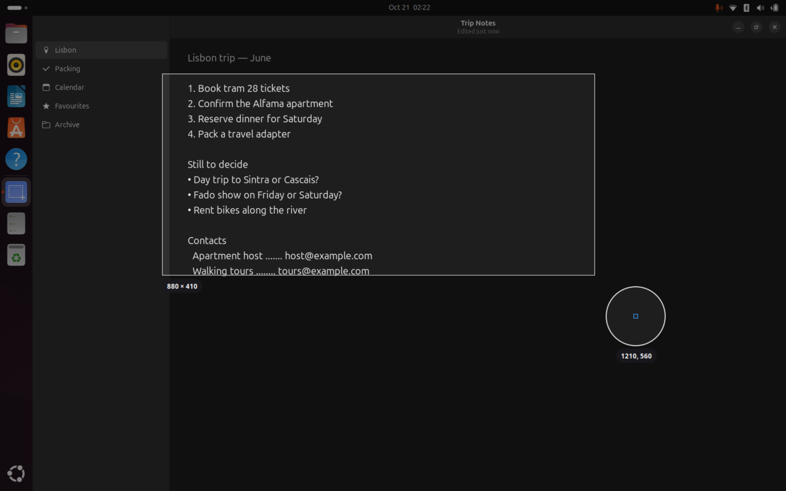
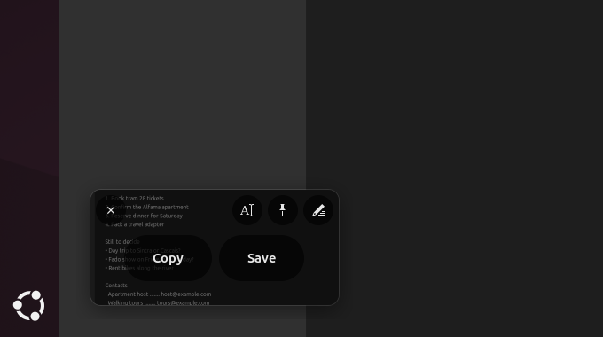
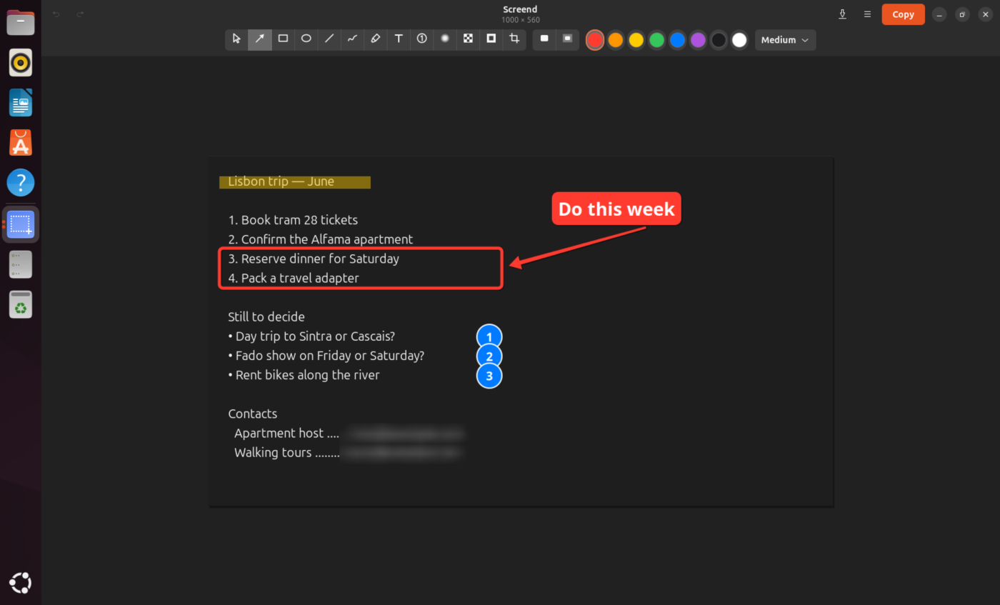
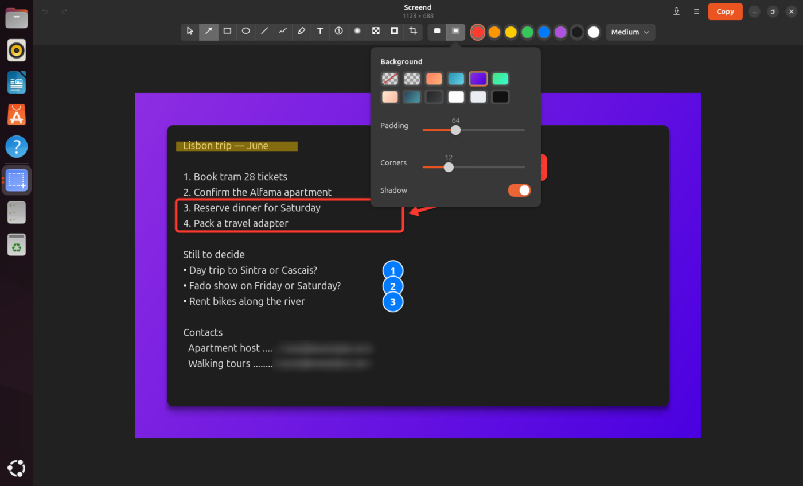
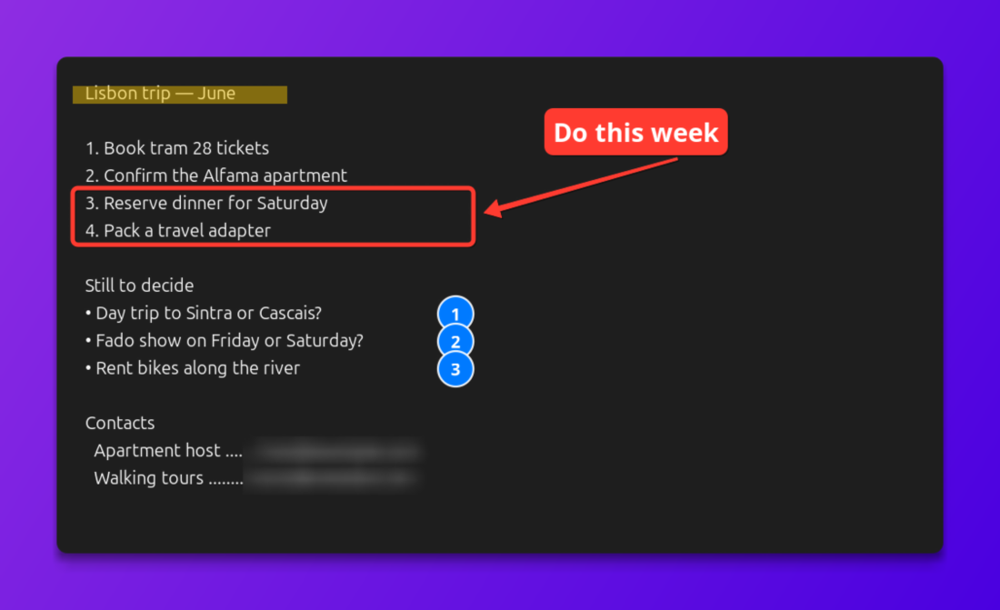
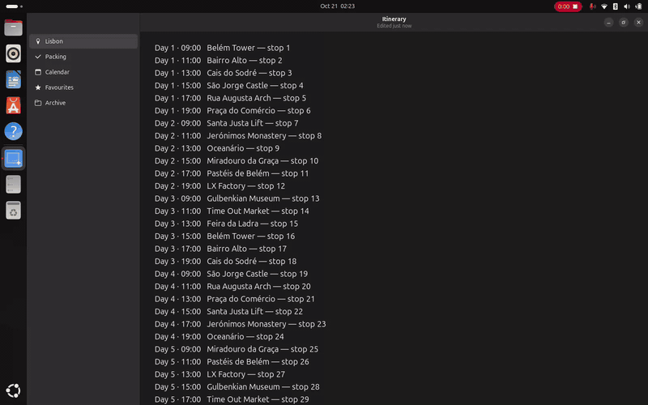
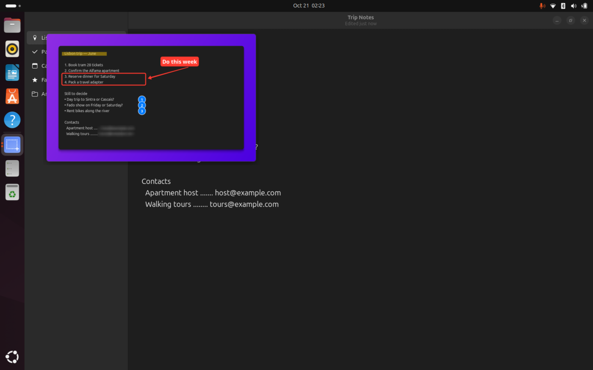
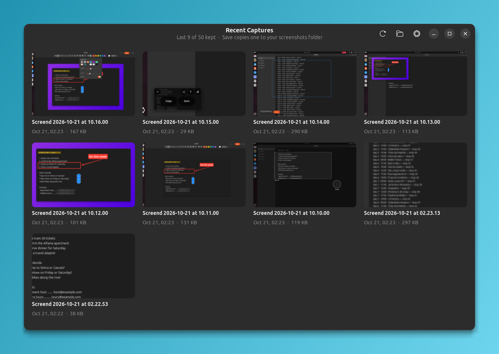
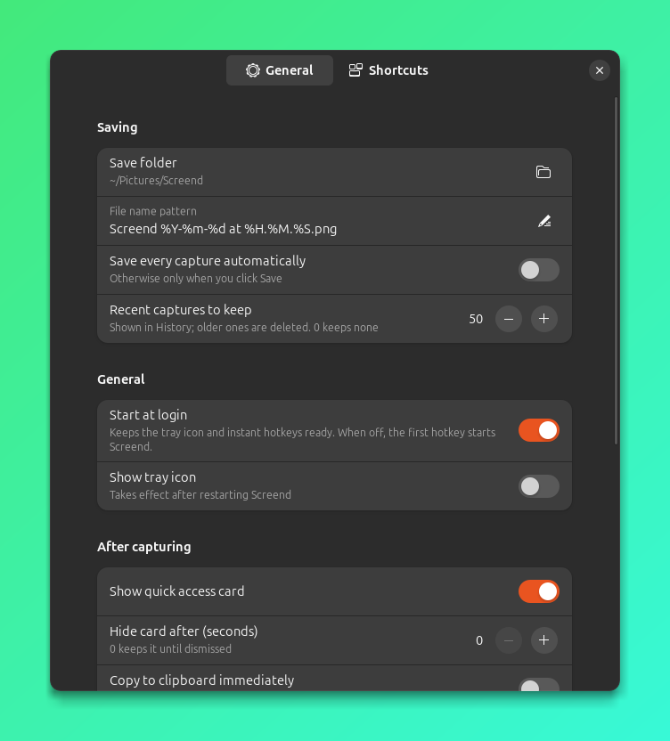

# Screend user guide

- [Getting started](#getting-started)
- [Capturing](#capturing)
- [After a capture: the card](#after-a-capture-the-card)
- [The editor](#the-editor)
- [Scrolling capture](#scrolling-capture)
- [Copying text (OCR)](#copying-text-ocr)
- [Pinned screenshots](#pinned-screenshots)
- [Screen recording](#screen-recording)
- [History, tray and settings](#history-tray-and-settings)
- [Command line](#command-line)
- [Where things are stored](#where-things-are-stored)
- [Troubleshooting](#troubleshooting)

## Getting started

1. Run `./install.sh --keybindings` from the source folder. This installs Screend for your user, starts it at login, adds a tray icon and (on GNOME) installs the Shell extension and global shortcuts.
2. **On GNOME, log out and back in once.** GNOME only loads new extensions at login. Until you do, Screend works through the standard screenshot portal, which is slower (about a second per capture) and can't snap to windows.
3. Press <kbd>Shift</kbd>+<kbd>Super</kbd>+<kbd>S</kbd> and drag over something.

The first capture without the extension may ask whether Screend may take screenshots. Allow it once.

To check the extension is running, open **About Screend** from the tray menu and look under **Troubleshooting**.

## Capturing

| Mode | Shortcut | Command |
|---|---|---|
| Area, window or screen (you choose) | <kbd>Shift</kbd>+<kbd>Super</kbd>+<kbd>S</kbd> | `screend` |
| Focused window | <kbd>Shift</kbd>+<kbd>Super</kbd>+<kbd>W</kbd> | `screend window` |
| Screen under the pointer | <kbd>Shift</kbd>+<kbd>Super</kbd>+<kbd>D</kbd> | `screend screen` |
| All screens | <kbd>Shift</kbd>+<kbd>Super</kbd>+<kbd>A</kbd> | `screend fullscreen` |
| The previous area again | <kbd>Shift</kbd>+<kbd>Super</kbd>+<kbd>R</kbd> | `screend last` |
| Text in an area | <kbd>Shift</kbd>+<kbd>Super</kbd>+<kbd>T</kbd> | `screend text` |
| Scrolling capture | <kbd>Shift</kbd>+<kbd>Super</kbd>+<kbd>C</kbd> | `screend scroll` |

Add `-d 3` to any command to wait three seconds first, for example to open a menu before the capture.

### The selector



When you start an area capture, the screen freezes and dims.

| To | Do |
|---|---|
| Capture an area | Drag. Selections can cross monitors. |
| Capture a window | Hover it (it gets a blue outline) and click. |
| Capture a whole screen | Click on the desktop, or press <kbd>Enter</kbd>. |
| Move the selection while dragging | Hold <kbd>Space</kbd> (GNOME). |
| Cancel | <kbd>Esc</kbd> or right-click. |

The magnifier next to the pointer shows the pixels around it and their exact coordinates, so you can line up a selection precisely.

**Adjust before capturing.** Turn on *Adjust selection before capturing* in Settings, and releasing the mouse no longer captures straight away. Instead:
- drag the handles to resize
- drag inside the selection to move it
- use the arrow keys to nudge it (<kbd>Shift</kbd>: 10 px; <kbd>Ctrl</kbd>: resize)
- press <kbd>Enter</kbd> or double-click to capture

Window snapping and adjust-before-capture need the GNOME extension, or Hyprland or Sway for window snapping.

## After a capture: the card



Each capture shows a card in the bottom-left corner of the screen you're on. Hover it to see its buttons:

| Button | What it does |
|---|---|
| **Copy** | Puts the image on the clipboard. |
| **Save** | Saves a PNG to your screenshots folder (`~/Pictures/Screend` by default). |
| ✏️ Annotate | Opens the editor. You can also double-click the thumbnail. |
| 📌 Pin | Floats the image above your windows. |
| Aǀ Copy text | Reads the text in the image (OCR) and copies it. |
| ✕ | Dismisses the card. |

You can also **drag the thumbnail** straight into another app, for example a chat window, an email or a file manager.

The card hides itself after 8 seconds, unless your pointer is on it. Up to four cards stack if you capture several things in a row.

### Saving and history
Captures are **not** saved to your Pictures folder unless you click **Save** (or turn on *Save every capture automatically*). Every capture does go into your recent history, which keeps the latest 50 and deletes older ones. See [History](#history-tray-and-settings).

## The editor



Open it from the card, by double-clicking the card's thumbnail, or with `screend open picture.png`.

### Tools

| Key | Tool | Notes |
|---|---|---|
| <kbd>V</kbd> | Select / move | Click a shape to select it, then drag to move it. |
| <kbd>A</kbd> | Arrow | <kbd>Shift</kbd> snaps to 45°. |
| <kbd>R</kbd> | Rectangle | <kbd>Shift</kbd> makes a square. |
| <kbd>O</kbd> | Ellipse | <kbd>Shift</kbd> makes a circle. |
| <kbd>L</kbd> | Line | <kbd>Shift</kbd> snaps to 45°. |
| <kbd>P</kbd> | Pen | Freehand. |
| <kbd>H</kbd> | Highlighter | <kbd>Shift</kbd> keeps it horizontal. |
| <kbd>T</kbd> | Text | Click to type. <kbd>Shift</kbd>+<kbd>Enter</kbd> adds a line, <kbd>Enter</kbd> finishes, <kbd>Ctrl</kbd>+<kbd>V</kbd> pastes. |
| <kbd>N</kbd> | Counter | Numbered steps: 1, 2, 3… |
| <kbd>B</kbd> | Blur | Smoothly blurs an area. |
| <kbd>X</kbd> | Pixelate | Blocky; better for hiding sensitive text. |
| <kbd>S</kbd> | Spotlight | Darkens everything except the area. |
| <kbd>C</kbd> | Crop | Drag the area to keep. <kbd>Shift</kbd> makes a square. |

### Styles
- **Colours:** the eight swatches, or keys <kbd>1</kbd>–<kbd>8</kbd>.
- **Stroke:** Thin, Medium or Thick.
- **Fill** (<kbd>F</kbd>): solid rectangles and ellipses, and text on a coloured label.

Changing a style while a shape is selected restyles that shape.

### Working with shapes
- A freshly drawn shape stays selected. Drag its handles to reshape it, or drag the shape to move it.
- Arrow keys nudge the selected shape (<kbd>Shift</kbd>: 10 px). <kbd>Delete</kbd> removes it.
- <kbd>Ctrl</kbd>+<kbd>Z</kbd> undoes and <kbd>Ctrl</kbd>+<kbd>Shift</kbd>+<kbd>Z</kbd> redoes, for every change including crops.

### Zoom
<kbd>Ctrl</kbd>+scroll, or <kbd>Ctrl</kbd>+<kbd>+</kbd> / <kbd>Ctrl</kbd>+<kbd>-</kbd>. <kbd>Ctrl</kbd>+<kbd>0</kbd> fits the window and <kbd>Ctrl</kbd>+<kbd>1</kbd> shows actual pixels. When zoomed in, scroll or middle-drag to pan.

### Background
Press <kbd>G</kbd>, or click the background button next to the fill toggle.



- **Backdrop:** none, transparent, a gradient or a solid colour.
- **Padding:** the space around the screenshot.
- **Corners:** how rounded the screenshot's corners are.
- **Shadow:** a soft shadow under the screenshot.

Your choice is remembered for the next capture.



### Finishing
| | |
|---|---|
| **Copy** (<kbd>Ctrl</kbd>+<kbd>C</kbd>) | Copies the finished image and closes the editor. |
| Save (<kbd>Ctrl</kbd>+<kbd>S</kbd>) | Saves to your screenshots folder. |
| Save As (<kbd>Ctrl</kbd>+<kbd>Shift</kbd>+<kbd>S</kbd>) | Choose where to save. |
| ☰ menu | Pin to Screen, Copy Text (OCR), Show in Folder, History, Settings, About. |

Closing with unapplied changes asks whether to keep them. **Apply** updates the card, the history copy and any saved file.

## Scrolling capture



1. Press <kbd>Shift</kbd>+<kbd>Super</kbd>+<kbd>C</kbd> and select the part of the window that scrolls. Clicking a window selects the whole window.
2. A blue outline marks the area, and a small panel appears in the corner.
3. Scroll the content down at a normal pace. The panel counts the pixels captured so far.
4. Press **Done**, <kbd>Enter</kbd>, or the shortcut again. <kbd>Esc</kbd> cancels.

The stitched image goes to the card like any other capture.

Tips:
- Select only the scrolling content if you can. Fixed headers and footers are detected and kept once, but a selection that includes changing parts (videos, animations, a blinking cursor) can confuse the stitching.
- If the image is missing a section, you probably scrolled faster than Screend could grab frames. Scroll a little slower.
- Scrolling back up is ignored. Images stop at 40,000 pixels tall.

Scrolling capture needs a fast way to grab the screen: the GNOME extension, `grim` on Hyprland or Sway, or KDE's fast capture (see [Troubleshooting](#troubleshooting)).

## Copying text (OCR)

Install Tesseract first: `sudo apt install tesseract-ocr` (Fedora: `tesseract`, Arch: `tesseract` plus a language package).

- Press <kbd>Shift</kbd>+<kbd>Super</kbd>+<kbd>T</kbd> and select an area. The text goes to your clipboard, and a notification shows the first few words.
- Or use the **Copy text** button on a card, or **Copy Text (OCR)** in the editor's ☰ menu.

For other languages, install the matching Tesseract data (for example `tesseract-ocr-deu`) and set *Languages* in Settings to something like `eng+deu`.

Small text is enlarged before it's read, which helps a lot with menus and UI labels. Recognition is never perfect, so check the result before relying on it.

## Pinned screenshots



Pin a capture from its card, or from the editor's ☰ menu, to keep it floating above your windows on every workspace.

| | |
|---|---|
| Drag | Move it |
| Scroll | Resize |
| <kbd>Ctrl</kbd>+scroll | Change opacity |
| Right-click | Copy, Annotate or Close |
| Double-click or <kbd>Esc</kbd> | Close |

## Screen recording

Press <kbd>Shift</kbd>+<kbd>Super</kbd>+<kbd>V</kbd> (or **Record Screen…** in the tray), select an area, window or screen, and recording starts. Press the shortcut again, or the stop button, to finish. `screend record --screen` skips the selection and records the screen under the pointer.

- **On GNOME with the extension**, Screend uses GNOME's built-in recorder. You get the usual red indicator in the top bar, and its stop button works too.
- **Elsewhere**, the desktop asks which screen or window to share. Screend remembers your choice, so later recordings start straight away.

Recordings are WebM videos. The card for a recording has **Copy** (copies the file), **Save**, and **GIF**, which converts the recording to a GIF and copies that. GIF frame rate and width are in Settings. Double-click the card to play the video.

## History, tray and settings



**History** (`screend history`, or from the tray) shows your most recent captures and recordings.
- Click an image to open it in the editor.
- Right-click for Copy, Save to Screenshots Folder, Show in Folder or Remove from History.
- Drag a tile into another app.

The folder button opens your saved screenshots.

**The tray icon** has every capture mode, recording, History, Settings, About and Quit. While a recording runs, the icon turns into a red dot and the menu offers **Stop Recording**.



**Settings** (from the tray, the History window or the editor's ☰ menu):

| Setting | Default |
|---|---|
| Save folder | `~/Pictures/Screend` |
| File name pattern | `Screend %Y-%m-%d at %H.%M.%S.png` (strftime codes) |
| Save every capture automatically | off |
| Recent captures to keep | 50 (0 keeps none) |
| Start at login | on |
| Show tray icon | on |
| Show quick access card | on |
| Hide card after | 8 seconds (0 keeps it until dismissed) |
| Copy to clipboard immediately | off (reliable only with the GNOME extension) |
| Adjust selection before capturing | off |
| Text recognition languages | `eng` |
| Recording: show mouse pointer | on |
| GIF frame rate / maximum width | 15 fps / 960 px |

## Command line

```
screend [ACTION] [FILE] [-d SECONDS] [--screen]

  region       area, window or screen (default)
  window       focused window
  screen       screen under the pointer
  fullscreen   all screens
  last         previous area again
  text         copy the text in an area (OCR)
  scroll       start, or finish, a scrolling capture
  record       start or stop a recording (--screen: record the current screen)
  open FILE    annotate an image
  history      recent captures
  settings     preferences
  folder       open the screenshots folder
  quit         stop Screend
```

Screend runs as a single background instance. Each command is handed to it, so commands return immediately.

## Where things are stored

| What | Where |
|---|---|
| Settings | `~/.config/screend/config.json` |
| Recent captures (history) | `~/.cache/screend/history/` |
| Saved screenshots | `~/Pictures/Screend/` (configurable) |
| The app | `~/.local/share/screend/`, launcher `~/.local/bin/screend` |
| GNOME extension | `~/.local/share/gnome-shell/extensions/screend@jksnetwork.github.io/` |
| Login service | `~/.config/systemd/user/screend.service` |

## Troubleshooting

**Captures are slow, or clicking doesn't snap to windows (GNOME).**
The extension isn't running. Log out and back in after installing. **About Screend → Troubleshooting** shows its state. If it still isn't running, check that `screend@jksnetwork.github.io` is enabled in the Extensions app.

**A window opens behind others, or GNOME says "Screend is ready".**
The same cause: without the extension, GNOME won't bring windows opened from a shortcut to the front.

**Pasting doesn't work after "Copy to clipboard immediately".**
Wayland only lets the focused app set the clipboard. With the GNOME extension this works. Without it, use the card's **Copy** button.

**Copy text says Tesseract is missing.**
Install `tesseract-ocr` (see [Copying text](#copying-text-ocr)).

**Scrolling capture says it isn't supported.**
It needs the GNOME extension, `grim` (Hyprland/Sway), or KDE fast capture.

**KDE: capture is slow or scrolling capture is unavailable.**
KWin's fast screenshot interface is only available to apps that request it. `./install.sh --kde-fast-capture` grants it to your system's `python3` interpreter, since Screend runs on Python. Be aware this also covers other Python programs you run. Without it, Screend uses the portal.

**Reporting a bug.**
Open **About Screend → Troubleshooting**, use *Save debug info*, and attach the file to your report.

**Uninstalling.**
`./install.sh --uninstall` removes the app, extension, service and shortcuts. Your saved screenshots stay where they are.
